# Post-contenido — Unidad 5: Integración en Aplicaciones Web

## Descripción
Repositorio del post-contenido de la Unidad 5 de Patrones de Diseño de Software. Un único proyecto
Spring Boot (`reservas-labs-api`) para la reserva de laboratorios de cómputo de la universidad, con dos
partes:
- una **API REST en capas** (Entity, Repository, Service, Controller) sobre H2;
- una **vista Thymeleaf** (MVC clásico) que reutiliza exactamente el mismo `ReservaService`.

## Arquitectura en capas
```
                ┌──────────────────────────┐      ┌──────────────────────────────┐
  Cliente REST  │ controller/              │      │ web/                         │  Navegador
  (JSON)  ────► │  ReservaController       │      │  ReservaWebController        │ ◄──── (HTML)
                │  LaboratorioController   │      │  ReservaWebExceptionHandler  │
                │ exception/               │      │ templates/reservas/*.html    │
                │  GlobalRestExceptionHandler      └──────────────┬───────────────┘
                └────────────┬─────────────┘                     │
                             │        misma instancia (singleton) │
                             ▼                                    ▼
                ┌───────────────────────────────────────────────────────────┐
                │ service/ReservaService   (@Transactional)                 │
                │  reglas: horario 07–21, duración 30 min–3 h, mismo día,   │
                │          solapamiento, cancelación tardía o repetida      │
                │  lanza: ReservaInvalidaException · ReservaConflictException│
                │         RecursoNoEncontradoException                      │
                └────────────┬──────────────────────────────────────────────┘
                             ▼
                ┌───────────────────────────────────────────────────────────┐
                │ repository/  ReservaRepository (JPQL buscarSolapamientos) │
                │              LaboratorioRepository                        │
                └────────────┬──────────────────────────────────────────────┘
                             ▼
                model/ Laboratorio ◄──@ManyToOne── Reserva      (H2 en memoria)
```

| Paquete | Responsabilidad |
|---|---|
| `model/` | Entidades JPA `Laboratorio`, `Reserva` (FK `laboratorio_id`) y el enum `EstadoReserva`. Validaciones de formato con Bean Validation. |
| `repository/` | Patrón Repository sobre `JpaRepository`. `ReservaRepository` agrega la consulta JPQL `buscarSolapamientos`. |
| `service/` | `ReservaService`: todas las reglas de negocio de reservas y la transacción. |
| `exception/` | Excepciones de dominio y `GlobalRestExceptionHandler` (solo `@RestController`). |
| `controller/` | API REST `/api/reservas` y `/api/laboratorios`. |
| `web/` | Controlador MVC `/reservas` y su manejador de errores (solo `ReservaWebController`). |
| `config/` | `DatosIniciales`: carga 3 laboratorios de ejemplo al arrancar. |

## Parte 1 — Repository, Service y Controller REST
`LaboratorioRepository` y `ReservaRepository` extienden `JpaRepository`. `ReservaRepository` agrega
una consulta JPQL propia para detectar solapamientos de horario. `ReservaService` concentra las reglas
de negocio: solapamiento, horario de atención, duración, cancelación tardía y cancelación repetida.
`ReservaController` y `LaboratorioController` exponen `/api/reservas` y `/api/laboratorios`.

| Método | Ruta | Respuesta |
|---|---|---|
| GET | `/api/laboratorios` | 200 — catálogo |
| GET | `/api/laboratorios/{id}` | 200 / 404 |
| POST | `/api/laboratorios` | 201 / 400 (validación) |
| GET | `/api/reservas` | 200 — todas las reservas |
| GET | `/api/reservas/{id}` | 200 / 404 |
| GET | `/api/reservas/laboratorio/{laboratorioId}` | 200 / 404 si el laboratorio no existe |
| POST | `/api/reservas` | **201** creada · **409** horario solapado · **400** fuera de horario, duración inválida o campos mal formados · **404** laboratorio inexistente |
| DELETE | `/api/reservas/{id}` | **204** cancelada · **409** ya inició o ya estaba cancelada · **404** |

## Parte 2 — Vista MVC con Thymeleaf
`ReservaWebController` expone `/reservas` con Thymeleaf e inyecta la **misma instancia** de
`ReservaService` que usa la API REST, sin un Service duplicado. `ReservaWebExceptionHandler` maneja las
mismas excepciones de dominio que `GlobalRestExceptionHandler`, pero las presenta distinto: redirección
con mensaje en vez de JSON.

| Ruta MVC | Descripción |
|---|---|
| GET `/reservas` | Lista de reservas, con mensaje flash de éxito o error |
| GET `/reservas/nueva` | Formulario con el combo de laboratorios cargado desde la base |
| POST `/reservas` | Crea la reserva (mismas reglas que `POST /api/reservas`) |
| POST `/reservas/{id}/cancelar` | Cancela la reserva (mismas reglas que `DELETE /api/reservas/{id}`) |

## Cómo ejecutar
```
$ mvn clean package
$ mvn spring-boot:run          # o ./mvnw spring-boot:run (Windows: mvnw.cmd spring-boot:run)
$ mvn test                     # 38 pruebas
```
- API REST: http://localhost:8080/api/reservas
- Vista MVC: http://localhost:8080/reservas
- Consola H2: http://localhost:8080/h2-console (JDBC URL `jdbc:h2:mem:reservas_labs_db`, usuario `sa`, sin contraseña)

Ejemplo:
```
curl -X POST http://localhost:8080/api/reservas -H "Content-Type: application/json" \
  -d '{"laboratorio":{"id":1},"nombreSolicitante":"Ana Torres","correoSolicitante":"ana@udes.edu.co","inicio":"2026-11-10T09:00:00","fin":"2026-11-10T11:00:00"}'
```

## Decisiones de diseño

### Punto de decisión 1 — Ubicación de la validación de solapamiento
La regla "no reservar un laboratorio en un horario que se solapa con otra reserva activa" se divide en
dos responsabilidades:

- **Repository: la pregunta de datos.** `ReservaRepository.buscarSolapamientos(labId, inicio, fin)`
  responde *¿qué reservas activas de este laboratorio se cruzan con este rango?* La consulta JPQL
  (`r.inicio < :fin AND r.fin > :inicio AND r.estado <> CANCELADA`) se resuelve en el motor de base de
  datos. Así viajan a memoria solo las filas en conflicto (normalmente cero) y no todo el historial del
  laboratorio, que crece sin límite semestre a semestre. Usar `<` y `>` estrictos hace que un rango
  contiguo (11:00–12:00 después de 09:00–11:00) no cuente como solapamiento. Lo verifica
  `ReservaRepositoryTest`.
- **Service: la decisión de negocio.** `ReservaService.crear()` decide qué significa ese resultado. Si
  la lista no está vacía, rechaza la reserva con `ReservaConflictException` y un mensaje que nombra el
  laboratorio. El Repository nunca lanza excepciones de negocio ni conoce el concepto de "conflicto":
  solo devuelve filas.

**¿Qué pasaría si el Controller llamara directamente a `buscarSolapamientos()`?**
- La regla quedaría en la capa HTTP, y cada punto de entrada tendría que repetirla. Este proyecto
  ya tiene dos: la API REST y la vista MVC de la Parte 2. Basta con que uno lo olvide para guardar
  reservas solapadas.
- El Controller también tendría que coordinar en el orden correcto la carga del laboratorio, la
  validación de horario, la consulta y el `save`, dentro de una transacción que hoy aporta
  `@Transactional` en el Service.

**Alternativa descartada:** traer `findByLaboratorioId()` completo y comparar rangos en Java. Es
correcta para pocos datos, pero su costo crece con todas las reservas históricas del laboratorio,
aunque solo interesen las de un día.

### Punto de decisión 2 — Reglas con y sin apoyo del Repository
`validarHorarioYDuracion()` vive entera en `ReservaService`, con Java puro. Cubre cuatro reglas:
- el rango no puede estar invertido;
- la duración debe estar entre 30 minutos y 3 horas;
- la reserva debe estar dentro del horario 07:00–21:00;
- la reserva debe empezar y terminar el mismo día.

Ninguna de estas reglas necesita otra fila de la base: se deciden solo con los campos de la reserva
que se está creando.

**Criterio general:**
- Si la regla necesita comparar contra datos que **solo la base conoce** (otras reservas existentes),
  el Service se apoya en una consulta del Repository, pero conserva la decisión.
- Si la regla **solo depende del propio objeto**, involucrar al Repository sería una consulta
  innecesaria y acoplaría una regla de dominio pura a la persistencia.

Por eso además se valida primero lo barato (horario y duración) y después lo que cuesta una consulta
(solapamiento): una reserva a las 22:00 se rechaza sin tocar la base.

La regla del mismo día no venía en la guía. Sin ella, una reserva de 22:00 a 00:30 pasaba el filtro,
porque las 00:30 no son posteriores a las 21:00.

**Decisión complementaria: tres excepciones de dominio, no dos.** El código de la guía lanzaba
`ReservaConflictException` también en `validarHorarioYDuracion`, lo que habría convertido una reserva
a las 22:00 en un **409**. Eso contradice el checkpoint que exige un **400**. Se agregó
`ReservaInvalidaException`:

| Excepción de dominio | Cuándo | API REST | Vista MVC |
|---|---|---|---|
| `ReservaInvalidaException` | La reserva es inválida **por sí misma** (rango, duración, horario) | 400 | vuelve al formulario con el mensaje |
| `ReservaConflictException` | La reserva es válida pero **choca con el estado del sistema** (horario ocupado, cancelar una reserva ya iniciada o ya cancelada) | 409 | vuelve a la página de origen con el mensaje |
| `RecursoNoEncontradoException` | El laboratorio o la reserva no existen | 404 | vuelve a la lista con el mensaje |

Un 409 indica "reintenta cuando cambie el estado". Una reserva fuera del horario de atención nunca
será válida, sin importar qué otras reservas existan.

**Nota — `LaboratorioController` usa el Repository directamente.** El catálogo de laboratorios es un
CRUD sin reglas propias. Un `LaboratorioService` que solo delegara `findAll()`/`save()` sería el
antipatrón de **Service anémico** que se pide evitar. La capa Service se introduce cuando hay una regla
que la justifique, y `ReservaService` sí la tiene. Por eso `ReservaController` nunca toca un
Repository. Con el mismo criterio, `ReservaWebController` usa `LaboratorioRepository` solo para llenar
el combo del formulario, que es una lectura del catálogo sin reglas.

### Punto de decisión 3 — Cómo comparten Service el Controller MVC y el REST
Los dos controladores reciben por constructor la misma clase `ReservaService`, que Spring gestiona como
un **único bean singleton**:

- REST: [`ReservaController.java:14-16`](src/main/java/com/universidad/reservaslabs/controller/ReservaController.java#L14-L16).
  Usa el service en `crear` ([línea 33](src/main/java/com/universidad/reservaslabs/controller/ReservaController.java#L33))
  y en `cancelar` ([línea 38](src/main/java/com/universidad/reservaslabs/controller/ReservaController.java#L38)).
- MVC: [`ReservaWebController.java:18-23`](src/main/java/com/universidad/reservaslabs/web/ReservaWebController.java#L18-L23).
  Usa el service en `crear` ([línea 51](src/main/java/com/universidad/reservaslabs/web/ReservaWebController.java#L51))
  y en `cancelar` ([línea 58](src/main/java/com/universidad/reservaslabs/web/ReservaWebController.java#L58)).

Ninguno de los dos reimplementa la validación de solapamiento ni la de horario. La prueba
`ambosControladoresCompartenLaMismaInstanciaDeReservaService` comprueba con `assertSame` que es el
mismo objeto.

**Alternativa descartada:** copiar la validación dentro de `ReservaWebController`, o crear un
`ReservaWebService` casi idéntico. Cualquier corrección futura de la regla de solapamiento (por
ejemplo, dejar un margen de limpieza de 10 minutos entre reservas) tendría que hacerse en dos lugares.
Si una sola superficie quedara desactualizada, el navegador aceptaría reservas que la API rechaza.
Evitar esa duplicación es justamente la razón de ser de la capa Service.

**Qué sí es propio de cada controlador:** la validación de **formato** de la entrada (`@Valid`). En
REST produce un 400 con `errores` por campo. En MVC, con `BindingResult`, vuelve a mostrar el
formulario con los errores junto a cada campo y conserva lo digitado. Es presentación del error de
formato, no una regla de negocio. La versión original de la guía no usaba `@Valid` en el formulario,
así que un nombre vacío llegaba hasta JPA y terminaba en un error 500.

### Punto de decisión 4 — Manejo de errores consistente entre MVC y REST
Hay dos manejadores, cada uno restringido a su superficie:
- `GlobalRestExceptionHandler` usa `@RestControllerAdvice(annotations = RestController.class)` y
  responde JSON con código HTTP.
- `ReservaWebExceptionHandler` usa `@ControllerAdvice(assignableTypes = ReservaWebController.class)`
  y responde con una redirección más un *flash attribute* `error` que la plantilla muestra.

**Por qué no un único `@RestControllerAdvice` global:** serializa siempre a JSON, y el navegador
necesita una redirección con un mensaje legible en HTML. La alternativa de un único manejador que
inspeccione el header `Accept` funciona, pero agrega un `if (navegador) … else …` en cada una de las
tres excepciones. Mezcla en una clase dos formas de presentación que cambian por razones distintas:
el formato del JSON lo pide un cliente de la API y el diseño de la página lo pide un usuario.
Con dos manejadores se mantiene la misma separación que el resto del proyecto: una clase por
superficie, ambas alimentadas por el **mismo vocabulario de excepciones de dominio**.

`ReservaService` no sabe quién lo llamó, y los dos manejadores muestran **el mismo mensaje** de la
excepción. Lo verifica la prueba `reservaSolapadaEnMvcMuestraElMismoMensajeQueLaApiRest`, y se ve en
las capturas 02 y 07b.

**Ajuste sobre la guía:** el manejador MVC original redirigía **todo** conflicto a `/reservas/nueva`.
Si fallaba una cancelación desde la lista, el usuario terminaba en el formulario de creación. Ahora el
manejador recibe el `HandlerMethod` de origen y vuelve a la página desde donde el usuario actuó:
formulario si falló `crear`, lista si falló `cancelar`.

**Limitación conocida:** al redirigir tras un error de negocio, el formulario vuelve vacío y el
usuario debe digitar de nuevo los datos. Se aceptó para mantener el patrón Post/Redirect/Get, que
evita reenvíos al recargar la página. Los errores de formato no tienen esta limitación porque no
redirigen.

## Evidencia (capturas)
Generadas contra la aplicación en ejecución (`mvn spring-boot:run`). Las de la API son la salida real
de `curl -i` y las de la vista son del navegador.

### API REST
**Reserva en horario libre → 201**
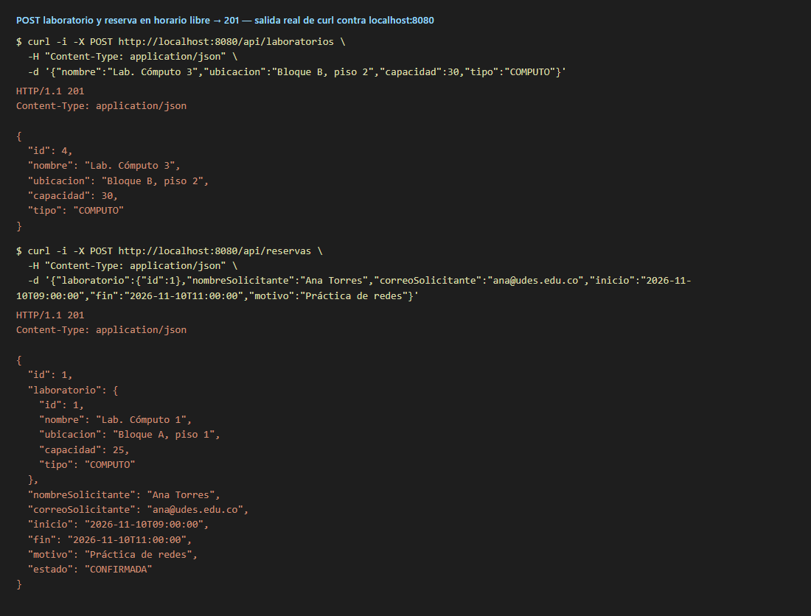

**Reserva solapada → 409 Conflict**
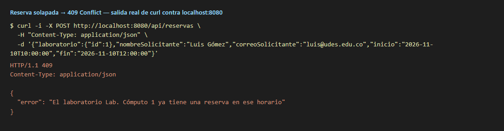

**Fuera del horario de atención, duración inválida y campos mal formados → 400**
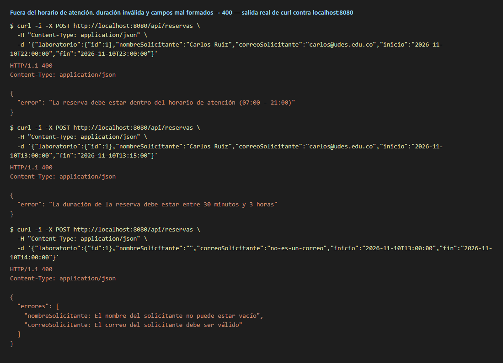

**Consulta por laboratorio, cancelación (204) y recursos inexistentes (404)**
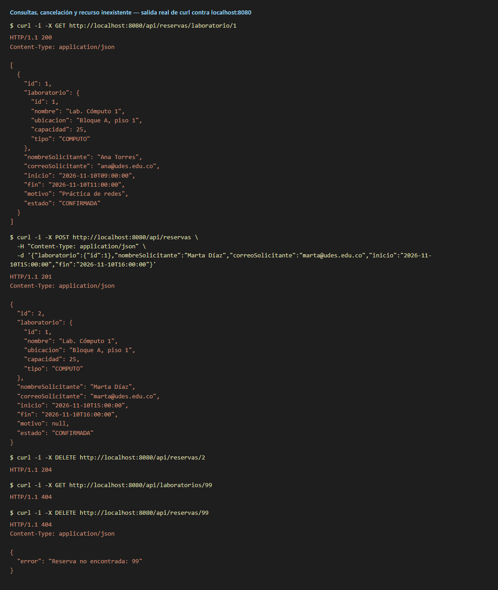

### Vista MVC (Thymeleaf)
**`/reservas/nueva`: formulario con el combo de laboratorios cargado desde la base**
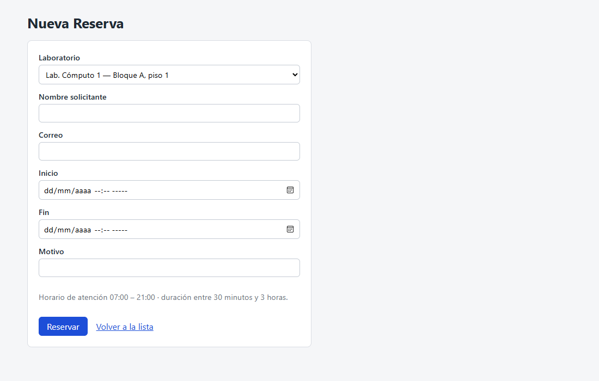

**`/reservas`: reserva creada desde el navegador**
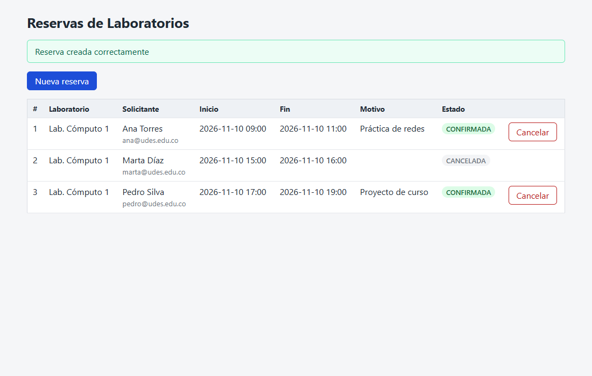

**Intento de reserva solapada (10:00–12:00 sobre 09:00–11:00) en el formulario…**
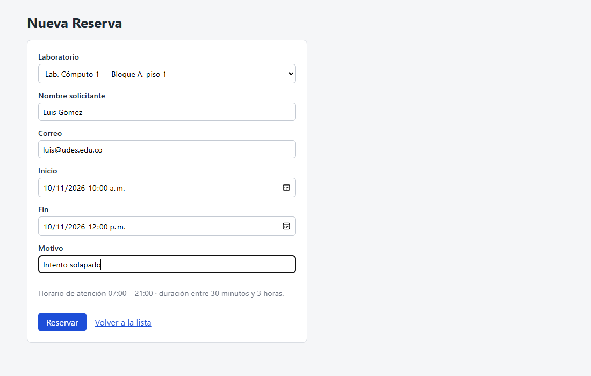

**…muestra el mismo mensaje de negocio que la API REST devuelve en JSON (captura 02)**
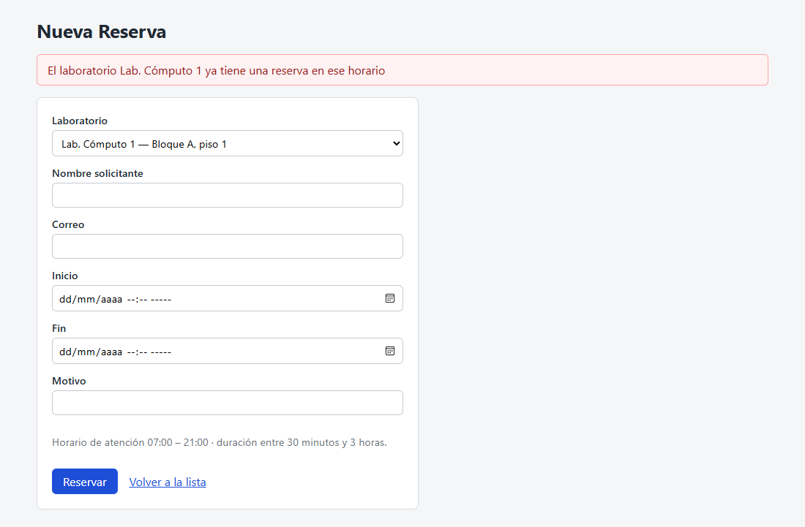

**Fuera del horario de atención**
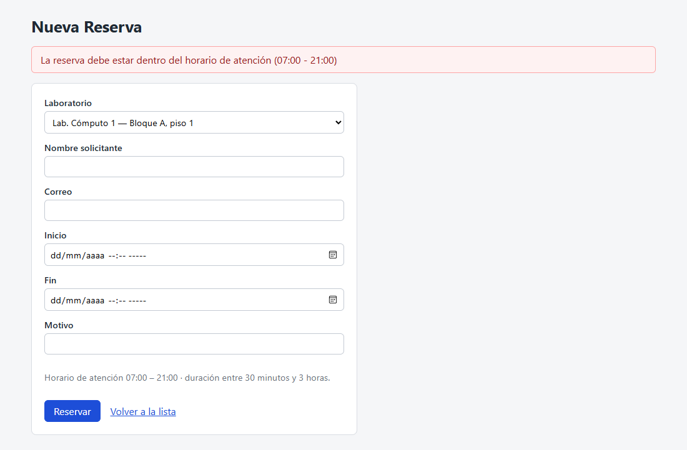

**Errores de formato junto a cada campo (sin perder lo digitado)**
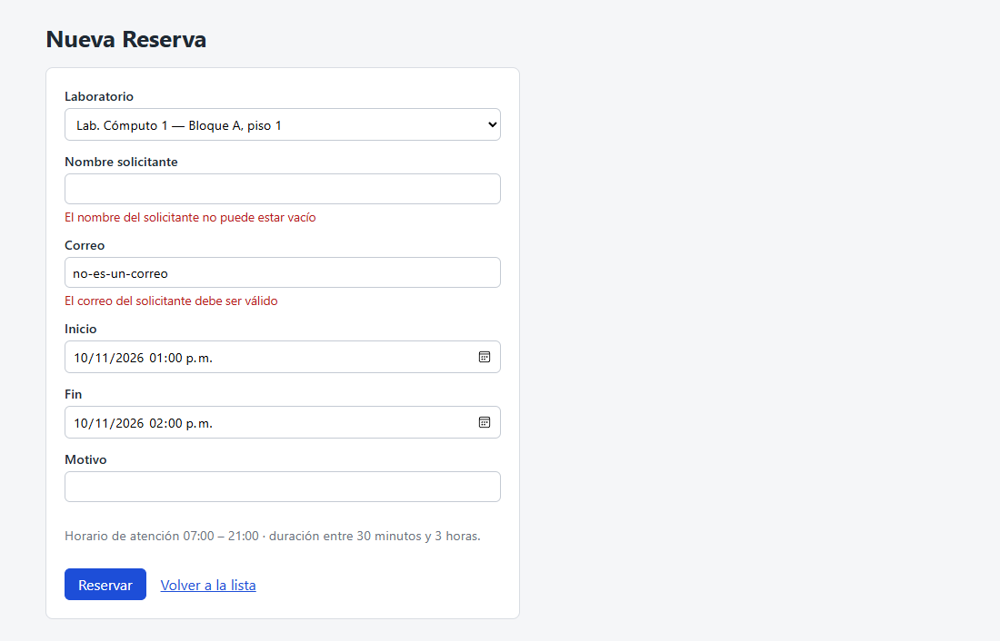

**Cancelación desde la lista**
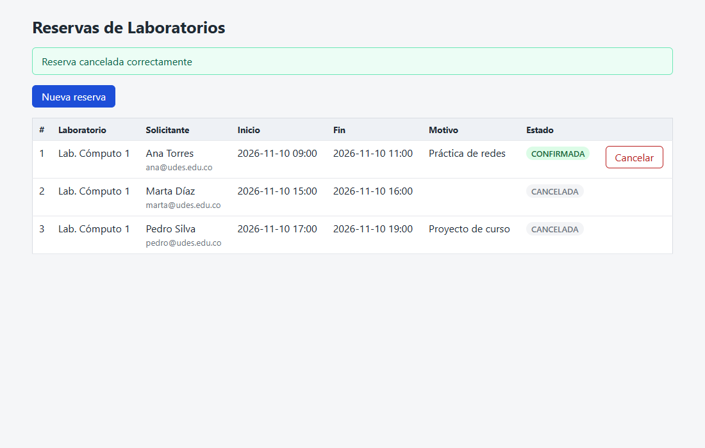

### Consola H2
| Tablas generadas por Hibernate | Clave foránea `laboratorio_id` |
|---|---|
| 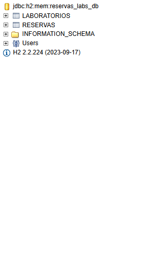 | 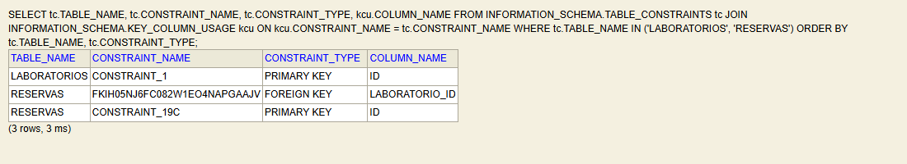 |

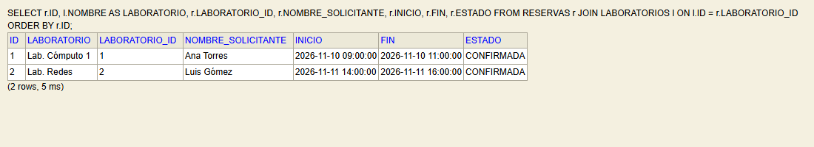

## Pruebas
`mvn test` ejecuta 38 pruebas:

| Clase | Qué valida |
|---|---|
| `ReservaRepositoryTest` (5) | La consulta JPQL: solapamiento parcial y contenido, rangos contiguos, canceladas, otro laboratorio. |
| `ReservaServiceTest` (11) | Cada regla de negocio y su excepción (horario, duración, medianoche, rango invertido, solapamiento, cancelación tardía o repetida, laboratorio inexistente). |
| `ReservaControllerTest` (11) | Checkpoints de la API: 201, 409, 400 (negocio y formato), 404, 204, y que cancelar libera el horario. |
| `ReservaWebControllerTest` (11) | Vista MVC: lista, formulario, creación, errores de negocio y de formato, cancelación, mismo mensaje que REST, misma instancia de Service, y que el manejador MVC no interfiere con el JSON de la API. |

## Herramientas utilizadas
- Java 17, Spring Boot 3.2, Spring Data JPA, H2, Thymeleaf, Lombok, Bean Validation
- Apache Maven, curl, Git, GitHub

## Conclusiones
Lo más difícil no fue escribir las capas, sino decidir **qué pregunta** responde cada una.
- La regla de solapamiento parece una sola, pero tiene dos mitades: una de datos, que la base resuelve
  mejor y escala, y una de negocio, que debe quedar en un único lugar que todas las superficies
  compartan.
- Separar las reglas que necesitan la base de las que solo miran el propio objeto evitó consultas
  innecesarias y también aclaró el contrato HTTP. Al distinguir "inválida por sí misma" (400) de
  "choca con el estado" (409) apareció la tercera excepción de dominio.
- La Parte 2 confirmó el valor de la capa Service: agregar una interfaz completa en HTML no requirió
  tocar ni una línea de las reglas. Solo hubo que decidir cómo presentar los mismos errores.
- La capa Service no se agregó de forma mecánica: el catálogo de laboratorios no la necesita, porque
  no tiene reglas que la justifiquen.
